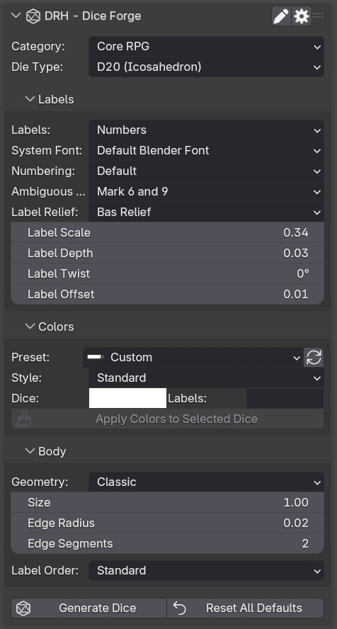

# DRH - Dice Studio

**A d20 with the numbers actually cut into the faces, not painted on a flat mesh.**

  

 

## Where this stands

Built to v1.0.0, development paused. Nothing downloadable here, no schedule promised.

Tabletop creators and dice makers: if this is the tool you've been looking for, [open an issue](https://github.com/pacosalasv/DRH_Dice_Studio-Support/issues) and describe the set you'd build.

## What it does

Mesh-only dice generation for tabletop and custom polyhedral sets, with body, label, and relief controls. Mesh-only matters if you print, because the geometry has to hold up outside Blender.

## Who it's for

Tabletop designers producing sets for print or render. Creators making dice for a game, a Kickstarter, or a shop listing. Anyone who tried to place 20 numbers on an icosahedron by hand.

## Why it's paused

The five released add-ons come first, and each has real user issues waiting. Dice Studio works, but it hasn't been through the pass that released tools get, and geometry that fails in someone else's slicer is a worse outcome than a delayed release.

[Open an issue](https://github.com/pacosalasv/DRH_Dice_Studio-Support/issues) with the set you'd make: standard d4 to d20, or a custom shape. Sharp-edge dice and rounded-edge dice need different handling, and knowing which one you want changes the priority.

Released DRH add-ons, all free: [Blender tools on BlendKit](https://www.blendkit.com/?query=category_subtree:addon+author_id:205846) · [DRH Hub](https://github.com/pacosalasv/DRH_Addons_Hub)

  

